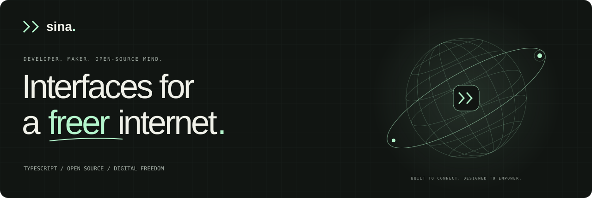

 

I'm **Sina**, a TypeScript developer interested in thoughtful interfaces, open source, and network freedom. I like turning complex systems into tools that feel clear, useful, and approachable.

[Explore my website](https://x0sina.com) · [Say hello on Telegram](https://t.me/x0sina) · [Browse my repositories](https://github.com/x0sina?tab=repositories)

 

### Selected work

Open-source projects featured in my portfolio. Follow each repository for its current documentation and contributors.

| Project | What it does | Explore |
| :--- | :--- | :--- |
| **PasarGuard Template** | A responsive subscription experience with four languages, dark mode, QR codes, and copyable connection links. | [Repository ↗](https://github.com/PasarGuard/subscription-template) |
| **PasarGuard Panel** | A censorship-resistant proxy management solution with a web dashboard, REST API, multi-node support, and traffic statistics. | [Repository ↗](https://github.com/PasarGuard/panel) |
| **Marzban Sub** | A customizable Marzban subscription template with English, Persian, and Russian support, application links, and copyable configurations. | [Repository ↗](https://github.com/x0sina/marzban-sub) |

 

### How I think about building

**Clarity over clutter.** Every interaction should earn its place.  
**Open by design.** Tools are better when people can explore, adapt, and improve them.  
**Freedom through good tools.** Privacy, access, and control matter from the start.

 

### In the toolkit

TypeScript · React · Next.js · Tailwind CSS · shadcn/ui · Vite · Node.js · Docker

 

---

**Good things start with a hello.**  
[Telegram / @x0sina](https://t.me/x0sina) · [x0sina.com](https://x0sina.com)

Thoughtfully built. Open by design.
